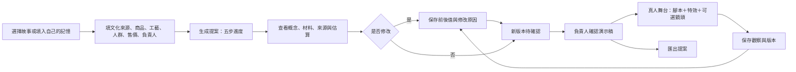

# 產品框架與交互設計

> 历史设计背景：当前 0.3.0 已转为四类意大利原产商品展示与反馈测试，暂停纺织配饰共创；以 [Italia 交付说明](08-italia-original-products.md) 为准。

0.2.0 更新：已增加合作工作台、分范围签收、询价样品与场次反馈。下文保留最初五页设计背景；当前功能与验收范围见 [分角色业务交付说明](07-role-based-delivery.md)。

## 1. 產品結構

暫定名稱「來物 LAIWU」，供牛客松原型使用。對消費者的語言：世界的故事，在這裡長出新東西。對品牌的語言：把第一份中國測款提案與反饋整理好。

| 頁面 | 使用者想完成的事 | 主要動作 | 結果 |
|---|---|---|---|
| 靈感集市 `#discover` | 理解文化共創是什麼 | 選擇一段故事 | 帶入工作台表單 |
| 共創工作台 `#studio` | 準備可講述的商品概念 | 填 brief、生成、修訂、確認、匯出 | 有版本與負責人的提案 |
| 真人舞台 `#live` | 用自己的表達展示作品 | 打開本機鏡頭、使用提詞、觸發角色互動 | 本機演示；不對外推流 |
| 測款復盤 `#insights` | 留住觀眾疑問與修改理由 | 記錄一次觀察、查看修訂歷史 | 與版本綁定的反饋資料 |
| 架構 `#architecture` | 理解背後的工作流 | 點選 Agent 節點 | 模型與規則分工說明 |

## 2. 主要交互路徑

輸入字段都有長度上限；商品先限定三類；售價是創作者設定的目標，不是市場建議價。素材與圖片上傳延後，因此沒有把未經授權的真實品牌圖片傳給模型。

生成期間展示的是後端執行狀態，不是假進度條。Mock 模板為了現場易讀，每個步驟約等待 350ms；這是刻意設定的展示延遲，不是實測推理耗時。

空白／錯誤：未創作時提供入口；失敗顯示階段與錯誤，允許重新生成；服務中斷後未完成任務標成 failed。網路失敗不會變成「成功的 AI 輸出」。

確認：勾選「已閱讀來源／权利／估算狀態」後才可進舞台。確認僅限本地演示，不代表素材正式商用許可。修改提案必須重新確認，舊版本不能沿用簽收。

## 3. 真人舞台與反數字人設計

真人是內容與即興互動的中心。AI 幫助準備故事、雙語話術、圖形與互動素材。第一版的角色是程式繪製的立體風格圖形，真人按鈕觸發三種表情／动作；不是音訊驅動的 3D 模型。

本地鏡頭需明確點擊才向瀏覽器申請授權；不錄影、不上傳、不取麥克風。離開舞台、切換項目或撤銷確認即停止鏡頭軌道。

| 狀態／聲明 | 首版顯示 | 正式產品的設計方向 |
|---|---|---|
| 真人主持 | 可申請真人專區，待人工確認 | 明確的主持責任人與有期限的參與驗證 |
| 真人＋AI 特效 | 可申請，明示 AI 輔助 | 標明特效／聲音／形象使用範圍 |
| 無人值守數字人 | 不符合真人專區聲明規則 | 轉入其他有標記的區域或人工申訴；不自動全站封禁 |
| 文字挑戰完成 | 演示互動已完成 | 首版結果不能作身分認證或活體證據 |

正式驗證應提供不必露臉的合理替代方式，對延遲、障礙或設備失敗保留人工處理。具體策略需以測試數據與業務規則落地，不能宣傳普遍有效的真假判別。

## 4. 輸出與責任人

| 輸出 | 機器責任 | 人的責任 | 首版實現 |
|---|---|---|---|
| 文化摘要 | 整理給定材料，標出未知 | 文化來源者與項目經理核查 | 未查證標記＋待確認項 |
| 商品概念 | 生成構想和材料建議 | 品牌／設計者確認授權與可用性 | 文本、配色、程式示意圖 |
| 供應估算 | 套用明示的示例規則 | 供應鏈負責人詢價、樣品與驗收 | 固定成本區間，無供應商背書 |
| 直播話術 | 雙語草稿與提問 | 真人主播選擇、修改與講述 | 中英開場與互動點子 |
| 演示確認 | 阻止未確認版本進入舞台 | 項目負責人確認此版 | 時間、版本、負責人、確認範圍 |
| 復盤 | 保存觀察與修訂 | 項目經理判斷偏差和下一步 | 手動記錄；未生成市場分數 |

## 5. 三小時活動安排

如果團隊有 4 人，可按角色分工；同一人可兼任。此表是活動工作建議，並非為此次開發啟動額外 Agent。

| 時間 | 產品／主持 | 前端 | 後端／Agent | 文化／商業 |
|---|---|---|---|---|
| 0–20 分 | 固定一個故事與展示目標 | 檢查首屏與手機版 | 啟動免密鑰服務 | 確認案例為虛構或已授权 |
| 20–75 分 | 寫一份清楚 brief | 跑通五頁 | 跑通狀態與確認 | 審稿、寫詢價問題 |
| 75–115 分 | 排練真人講述 | 舞台與角色 | 修訂／反饋／匯出 | 設計兩個觀眾問題 |
| 115–145 分 | 錄製備用演示 | 修窄螢幕問題 | 驗證錯誤與持久化 | 寫「誰付費、少做哪一步」 |
| 145–165 分 | 完整走一遍 3 分鐘 | 檢查字級與投屏 | 確認離線可用 | 對照三把尺子 |
| 165–180 分 | 鎖定版本，準備上台 | 停止新增功能 | 保留穩定服務 | 預備回答評委問題 |

上台驗收：一分鐘內觀眾理解創意，三分鐘內能看到一個完整循環，任何模擬能力都不冒充真實接入。視覺亮點由真人帶動，技術細節放在架構頁以供追問。
