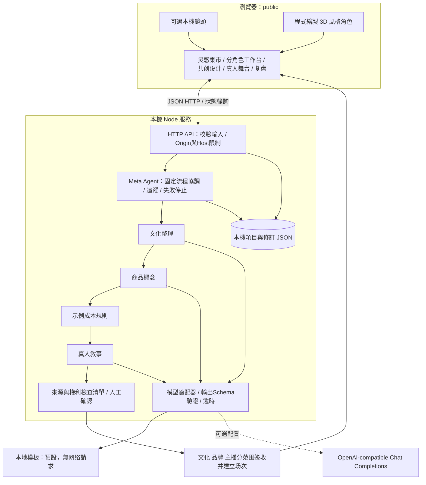
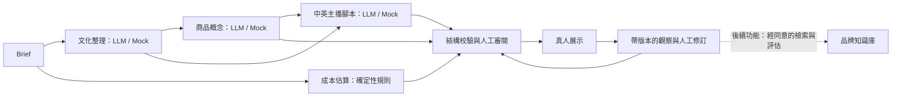
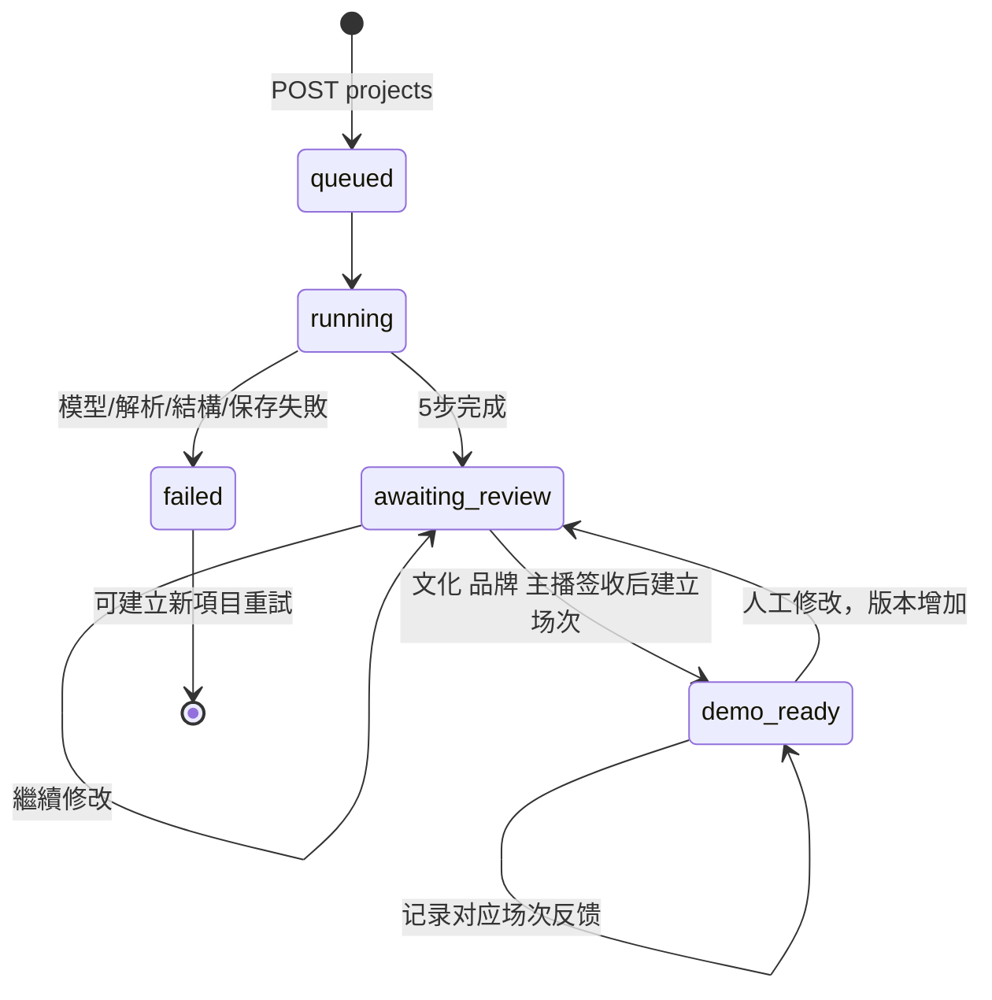
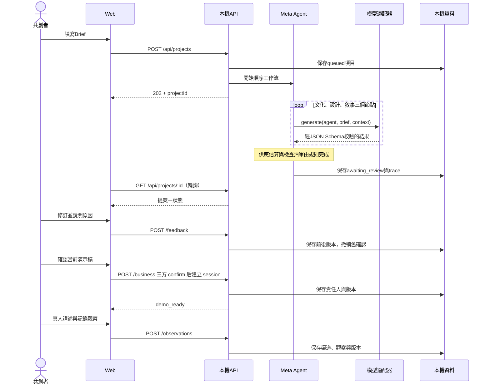

# 架構、工作流、元 Agent 與大模型接口

> 历史设计背景：当前 0.3.0 已转为四类意大利原产商品展示与反馈测试，暂停纺织配饰共创；以 [Italia 交付说明](08-italia-original-products.md) 为准。

版本 0.2.0：分角色业务状态、范围签收、询价样品和场次快照的完整契约见 [分角色技术交付说明](07-role-based-delivery.md)。本文保留生成与模型层设计，并更新关键接口。

## 1. 架構決策

首版採單一 Node.js 服務＋瀏覽器原生模組＋本機 JSON。其目的是免安裝第三方依賴、免密鑰、能在現場完整演示。它是可替換的業務模組框架，不是已完成的多租戶平台。原文建議的 React／Next／Nest／Prisma 可作後續選項，並非使用者已指定的必要技術。

採用固定順序協調器來實現元 Agent 的第一版：它管理依賴、驗證、狀態與人類確認，沒有自主接單、簽约或付款能力。增加模型數量不會自動提高效果；目前只在三個適合語言／創意輸出的步驟使用模型接口。

## 2. 系統與模型作用圖



鏡頭影像完全留在瀏覽器。API 密鑰只在服務端。模型接收 brief 和必要前置輸出；不接收攝影機資料、家庭資源或觀眾身份。



第一圖表示**現有順序執行**；第二圖表示**邏輯資料依賴**。後續可把無依賴的成本計算與其他工作並行，現有代碼為易理解與可追蹤而順序執行。

## 3. Agent 分工與邊界

| 元件 | 輸入 | 輸出 | 方式 | 不能做的事 |
|---|---|---|---|---|
| Meta Agent | 已校驗 Brief、流程定義 | project.status、trace、下一步 | 程式狀態機 | 不能自行改變發布和支付權限 |
| Culture Curator | Brief | origin、elements、interpretation、cautions | LLM / Mock | 不把個人故事判定為國別事實或非遺認證 |
| Product Designer | Brief＋culture | title、tagline、concept、materials、palette | LLM / Mock | 不聲稱授權、質檢或供應商合作已成立 |
| Supply Planner | 商品類型、目標售價 | 區間成本、示例 MOQ、交期、排除費用 | 規則 | 不生成假工廠與風險分數 |
| Live Director | Brief＋culture＋design | 中英開場、提問、互動點子 | LLM / Mock | 不替代真人主播、不能操控麥克風或發布 |
| Review Gate | 流程產物 | 來源／權利／估算待確認 | 規則＋人工 | 不進行實質法律審核或確證真假 |

現有系統沒有外部工具自主呼叫，所有副作用都由 API 白名單與人觸發。使用者文字和模型輸出均當作資料；不拼入 shell，不作為執行指令，不直接渲染 HTML。模型輸出不是可信的責任判斷。

## 4. 狀態機與順序





## 5. 資料模型

目前使用 Project 聚合，不複製原文數十張表。核心結構在 `server/workflow.mjs`。

```typescript
type ProjectStatus = 'queued' | 'running' | 'awaiting_review' | 'demo_ready' | 'failed';
type Brief = {
  country: string; story: string; craft: string; audience: string;
  productType: '陶瓷杯' | '帆布袋' | '裝飾燈';
  targetRetailPrice: number; // CNY 目标售价，50–500，非项目预算
  budget?: number; // 旧适配器兼容别名
  owner: string; // 演示負責人，尚未接入帳號身份
};
type Project = {
  id: string; brief: Brief; mode: 'mock' | 'openai-compatible';
  status: ProjectStatus; revision: number; createdAt: string; updatedAt: string;
  outputs: { culture?: object; design?: object; supply?: object; host?: object; review?: object };
  trace: { id: string; name: string; status: string; source: string; startedAt?: string; durationMs?: number; usage?: object | null }[];
  approval: { acknowledged?: true; owner: string; revision: number; at: string; scope: 'local-demo-only' } | null;
  feedback: { id: string; target: string; before: string; after: string; reason: string; owner: string; revision: number; at: string }[];
  observations: { id: string; channel: 'campus' | 'live'; decision: 'interested' | 'price_high' | 'unclear'; note: string; revision: number; at: string; sessionId?: string; contentRevision?: number; source: 'manual-demo-entry' | 'local-audience-demo' }[];
  business?: object; // 业务版本、范围、签收、规格、报价、样品、场次和日志，见分角色文档
  error: { code: string; message: string } | null;
};
```

下一版正式資料库可拆成 Workspace、Project、BriefRevision、Artifact、SourceClaim、ConsentRecord、AgentRun、ReviewDecision、Experiment、Observation。全部以 workspaceId 隔離；誰修改過什麼與能否重新使用各自存欄位。身份驗證後才可把 owner 替換為可信 userId。

## 6. 已實現 HTTP 契約

JSON 寫入接口要求 `Content-Type: application/json`，最大 16 KB，且 body 必須為物件。本文的接口是本工程契約，原附件接口並未全部實現。

| 方法與路徑 | 請求 | 成功回應／條件 |
|---|---|---|
| GET `/api/health` | 無 | 200 `{ok,mode,model,persistence,version}`；不含密鑰 |
| GET `/api/catalog` | 無 | 200 `{seeds,agents,routes,roles,knowledge,notice}` |
| POST `/api/projects` | `Brief` | 202 `Project`，在背景執行 |
| GET `/api/projects/:id` | 無 | 200 `Project` |
| POST `/api/projects/:id/approve` | 旧接口 | 409；请使用分范围签收与建立场次 |
| POST `/api/projects/:id/business` | action/role/expectedVersion/contentRevision/requestId + 动作字段 | 200 `Project`；见分角色契约 |
| POST `/api/projects/:id/feedback` | `{target,replacement,reason,expectedVersion,contentRevision}` | 200 `Project`；版本＋1，清除確認與未完成挑戰 |
| POST `/api/projects/:id/observations` | `{sessionId,requestId,channel,decision,note,useCase?}` | 200 `Project`；所选场次窗口开放且素材范围有效；可在新草稿期间收旧场次反馈 |
| GET `/api/projects/:id/export` | 無 | 200 Markdown 附件；包含來源狀態、修訂與觀察 |
| POST `/api/projects/:id/challenge` | `{}` | 201 `{id,phrase,expiresAt,assurance:'demo-only'}`；60秒，一項目一挑戰 |
| POST `/api/projects/:id/verify` | `{challengeId,answer}` | 200 `{status,assurance,message,checkedAt}`；單次使用，最多三次嘗試 |
| POST `/api/presence/policy` | `{mode:'human'或'human_with_ai'或'unattended'}` | 200 `{decision,label,nextAction,evidence}`；只按聲明展示規則 |

```json
{
  "country": "義大利",
  "story": "祖母家的藍色手繪陶器讓我想起一家人一起吃飯。",
  "craft": "佛山陶瓷與嶺南飲茶場景",
  "audience": "喜歡文化故事的城市青年",
  "productType": "陶瓷杯",
  "targetRetailPrice": 129,
  "owner": "演示項目負責人"
}
```

同步錯誤形狀：`{error:{code,message,requestId}}`。輸入錯誤 400；外部 Host／Origin 403；不存在 404；狀態衝突／容量上限 409；挑戰過期 410；過大 413；內容類型 415；缺少確認或挑戰錯誤 422；同時三個工作流忙碌 429；未預期錯誤 500。

模型錯誤在背景工作流中發生，因此讀取項目仍回 200，使用 `Project.status=failed` 和 `Project.error` 表示結果；不是所有模型 502 都直接傳成該輪詢请求的 HTTP 502。沒有自動重試或失敗覆寫，新的生成建立新項目。

## 7. 模型適配契約

```typescript
interface ModelProvider {
  mode: 'mock' | 'openai-compatible';
  model: string;
  generate(agent: 'culture' | 'design' | 'host', brief: Brief, context: object): Promise<{
    data: object;
    usage: {promptTokens: number | null; completionTokens: number | null} | null;
  }>;
}
```

適配器以 HTTPS 呼叫 `POST {AI_BASE_URL}/chat/completions`，使用服務端 Bearer 密鑰，拒绝重定向以降低憑證意外轉送風險。輸出支持 `json_schema`、`json_object`、`prompt` 三種配置，無論採哪一種，都須通過本地結構校驗。

`json_schema` 模式傳 `response_format: {type:'json_schema', json_schema:{name,strict:true,schema}}`；結構定義位於 `server/contracts.mjs`。JSON mode 只確保 JSON 形狀的能力與結構化輸出不同，不能略過本地驗證；模型可能拒答或輸出中斷，需要檢查拒答、finish_reason 與解析結果。[OpenAI Structured Outputs](https://developers.openai.com/api/docs/guides/structured-outputs)

Chat Completions 作為相容層是為了服務商可替換。若後續只使用 OpenAI，可另實作 Responses 適配器；本工程尚未實現它，不混用兩種接口的字段。[OpenAI Chat Completions](https://developers.openai.com/api/reference/resources/chat)

阿里雲也提供 OpenAI 相容 Chat API，但地區、模型和參數須按帳戶核對。本工程沒有硬編碼或假定任意模型都支援 JSON Schema，也沒有在未提供密鑰的情況下進行真實連線。[阿里雲接口文檔](https://help.aliyun.com/en/model-studio/qwen-api-via-openai-chat-completions)

默认單步逾時 20 秒、最多 1400 輸出 token，可依模型調整。一次共創最多 3 次模型請求，不做隱性重試。工作流軌跡保留步驟耗時和供應商回傳的 token 使用；沒有已驗證的單次費用估計。

## 8. 反饋資產與下一版學習設計

第一版：保存當前項目的人工修改，新稿輸出、舞台提詞與匯出都讀取修改後內容；修改觸發版本重新確認。這已能演示「主管改了一版，系統記得」。

下一版：在品牌授權範圍內，由負責人批准可以重用的修訂 → 寫入品牌規則庫 → 生成前檢索 → 記錄引用的規則ID → 在固定測試集評估重複錯誤是否下降 → 才發布規則新版本。不能直接把直播評論當事實，也不能跨品牌共享未授權的私有內容。

若需要可恢復的長工作流、分支和人工中斷，可以評估 LangGraph。其官方倉庫提供持久化執行、人類介入和記憶機制；是否引入應取決於工程需求，首版未把它列作依賴。[LangGraph 官方 GitHub](https://github.com/langchain-ai/langgraph)

## 9. 後續能力接入點（未實現）

| 能力 | 接入點 | 前置條件 |
|---|---|---|
| 授權文化資料 RAG | culture 節點之前 | 可追溯來源、授權範圍、引用粒度、人工更正 |
| 商品生圖 | design 之後另建媒體任務 | 素材授權、圖像來源標記、輸出審閱、成本限額 |
| ASR／同聲字幕 | 舞台媒體管線 | 明確同意、語言與延遲測試、敏感資料處理 |
| 3D 資產／即時動作 | 客戶端渲染＋素材服務 | 先準備模型資產，由真人動作或允許的事件驅動 |
| 對外直播 | RTC／直播供應商適配層 | 推流憑證、房間權限、設備測試、錄製與內容流程 |
| 供應商匹配 | supply 節點中的已審目錄 | 真實詢價、資料來源與更新日期；不推演無依據風險 |
| 市場實驗分析 | observations 的分析任務 | 樣本定義、曝光分母、去重、渠道偏差與付費證據 |

不將直播每一幀送入大模型來實現角色控制；先用真人輸入驅動預設動作，再把生成模型放在非同步內容準備環節。
