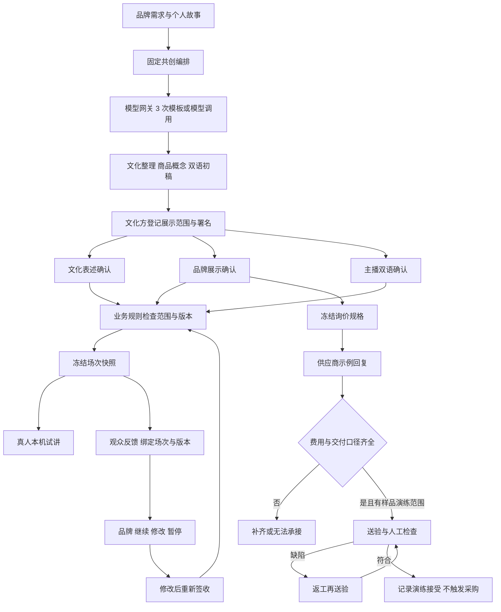

# 来物分角色业务交付与技术接入说明

> 历史设计背景：当前 0.3.0 已转为四类意大利原产商品展示与反馈测试，暂停纺织配饰共创；以 [Italia 交付说明](08-italia-original-products.md) 为准。

版本 0.2.0，2026-10-11。根据《来物LAIWU 分角色业务流程与页面设计方案 v1.1》，本次把品牌、文化创作者、供应商、真人主播与体验观众接入同一项目。附件中的 P1、P2 规划保留为后续建设项。

## 团队验收路径

启动 `node server/index.mjs`，打开 `http://127.0.0.1:3100/#work`。首次使用先到「共创设计」生成提案，建议选摩洛哥帆布袋示例。已有项目从浏览器保存的 ID 恢复。

1. 文化创作者：填写署名、来源依据、有效期，登记本机展示范围；需要演示样品流程时单独勾选，再确认文化讲述。
2. 品牌方：确认展示概念。项目边界分别记录品牌来源、生产地、发货地、卖方、进口方与确认人，未知保留待确认。
3. 品牌方：冻结询价规格，包含数量、尺寸公差、材料、工艺、包装、地点与验收要求。
4. 供应商：填写示例报价。先留空运费观察「待补齐」，再填入完整示例；也可以记录无法承接原因。
5. 品牌方：登记样品送验、缺陷返工、重新送验与演练接受。当前没有真实样品、合同或付款。
6. 主播：对照中文核对英文，签收双语讲稿。三方确认齐全后建立场次，进入本机舞台。
7. 观众：看故事、署名、材料、生产地与商品阶段，选择场次提交反馈，无需姓名或联系方式。
8. 品牌方：记录继续、修改或暂停的理由，下载含版本、范围、询价、样品和交接日志的 Markdown 交接包。

刷新会恢复最近项目和当前浏览器标签页的工作视角。角色切换是单机演示功能，不表示真实账号权限。

## 附件与本次实现对照

| 附件要求 | 已交付 | 当前边界 |
|---|---|---|
| 四张角色页面示意图 | 五种工作视角，增加文化方；共用项目与交接日志 | 本机演示 |
| 任务、交付物、交给谁 | 动态待办卡、下一步、责任角色与交接对象 | 无真实邀请与工期管理 |
| 前台与合作工作台分离 | 保留灵感集市，新增工作台，技术架构移到页脚 | 观众页面是本机预览，无公开分享服务 |
| R0–R5 路径 | 路径选择、来源/生产/发货/卖方等字段、路径说明 | R0/R1 可演练；R2–R5 仅资料准备 |
| 独立确认范围 | 文化、品牌展示、讲稿分别记录角色、版本、时间 | 无真实签名、授权合同或采购批准 |
| 素材撤回与到期 | 阻止新场次、新体验反馈；观众快照不再返回 | 已下载文件无法自动撤回 |
| 冻结规格后询价 | 独立规格版本、询价单、报价草稿、无法承接原因 | 一个虚构工坊，人民币同口径回复 |
| 未知费用不能当零 | 整数分计价，缺项为 null；费用、税口径、交期条件、有效期缺失时不算比较总额 | 不推算关税、汇率或真实利润 |
| 样品验收与返工 | 送验→待验收→返工→重新送验→演练接受 | 文本记录，未接文件存储与真实质检 |
| 中文修改后英文待核对 | 撤销当前签收，双语状态恢复待核对 | 由真人核对 |
| 独立停止按钮 | 停镜头、停止特效并遮住本机画面，可恢复 | 无外部推流，不能声称停止了外部直播 |
| 老反馈不能贴到新版 | 场次冻结快照；24 小时窗口；反馈绑定场次和版本 | 新草稿期间仍可收旧场次反馈；可提前关闭窗口 |
| 交付与费用分开 | 目标售价、预算、采购承诺、付款分别显示 | 预算未登记，采购和付款尚未开放 |
| 留学生自愿参与 | 不采集家族资产、家庭人脉或投资能力 | 学校、工作资格、服务合同待真实试点核对 |
| 账号、邀请与供应商隔离 | 明确列入下一阶段 | 尚未实现，不可公开部署当前服务 |
| 简体中文与英文 | 新工作台简体中文、英文角色标识、双语稿 | 旧页面保留繁体，无完整语言切换 |

## 业务流程与模型作用

R0 概念试讲不以样品验收为前置，样品是可选演练分支。文化整理、产品概念和双语初稿沿用三个生成节点；报价、版本、范围和样品状态由确定性规则判断。此次没有增加模型调用，没有把人工签收包装成 Agent 的自主决定。默认仍为免密钥模板，真实模型接口保持原有可选配置。

## 数据与版本

- `project.revision`：展示内容版本。业务边界、素材范围、中文/标语/英文修改使原签收失效。
- `business.version`：业务写入版本，与内容版本分别校验，防止旧页面覆盖新状态。
- `spec.revision`：询价规格版本。更新后旧报价不再比较，当前样品状态清空；旧报价保留。
- `confirmations`：scope、actor、contentRevision、时间和失效原因；scope 为 culture、brand、script。
- `rights`：本机展示/样品范围、署名、依据、有效期、撤回状态，带演示限定。
- `quotes`：整数分金额、可空费用、MOQ、天数、起算条件、含税状态、有效期、付款和验收约定。
- `sessions`：唯一 ID、序号、不可变内容快照、版本、反馈截止时间和开放/关闭状态。
- `observations`：sessionId、contentRevision、场景、类型、原话、来源、时间。旧版手动记录不伪造场次 ID。
- `decisions`：品牌决定、依据场次、理由、记录时版本；`audit` 保存交接日志。
- `receipts`：服务端幂等校验，不返回浏览器。相同编号重放不重复创建，不同内容复用编号报冲突。

业务写入先复制项目，验证成功后替换并保存 JSON；验证失败不部分修改原项目。视图中的范围有效性和报价完整性每次由服务端重新计算。

## 新增与调整的 API

`GET /api/catalog` 增加 routes、roles 和带来源的 knowledge。`GET /api/projects/:id` 返回业务视图、动态待办、报价缺项和场次放行条件。

`POST /api/projects/:id/business` 的公共字段是 `action`、`role`、`expectedVersion`、`contentRevision`、`requestId`，其余字段按动作填写。

| action | 演示角色 | 主要输入 |
|---|---|---|
| profile | brand | route 与项目边界字段 |
| rights | culture | state/display/sample/credit/evidence/expiresAt |
| confirm | 对应 culture/brand/host | scope、acknowledged；主播另填 openingEn |
| spec | brand | 品类、数量、尺寸、材料、工艺、包装、地点、验收 |
| quote | supplier | specRevision 与报价字段，或 declined/reason |
| sample | brand | quoteId、state、evidence，接受时 checked |
| session | host | 无附加字段，通过三方确认后冻结快照 |
| closeSession | host | sessionId |
| decision | brand | sessionId、decision、reason |

`POST .../feedback` 现在要求 expectedVersion、contentRevision，仍接收 target、replacement、reason。无单独幂等表，但旧版本请求不能重复产生修订。

`POST .../observations` 现在要求 sessionId、requestId、channel、decision、note，可选 useCase。以场次窗口判断能否录入，不要求当前草稿已重新签收。

旧 `/approve` HTTP 入口返回 409，引导分范围签收。旧项目读取时补齐业务结构，保留修订和观察；旧的单人确认不能直接开放新版舞台。

角色不匹配返回 403，过期版本/状态冲突返回 409，字段或确认缺失返回 422。角色白名单只检查演练流程：身份仍由客户端选择，任何本机操作者均可切换；不能当作认证或租户隔离。当前 GET 项目与导出包含整个本机项目数据。

## 业务知识来源

知识卡将业务事项转成需补齐的资料或问题，不输出“已合规”判断。适用范围由具体品类与办理主体核对。

- 文化合作强调持续知情同意、社群参与及权益；产品据此拆分来源、署名与用途。[UNESCO 非遗伦理原则](https://ich.unesco.org/en/ethics-and-ich-00866)
- 贸易术语不能替代付款、所有权、质量和争议的合同约定。[ICC Academy 说明](https://academy.iccwbo.org/incoterms/article/incoterms-2020-new-rules-old-problems/)
- 跨境零售进口的个人自用与不得再次销售要求，是 R3 与餐厅经营采购分开的依据。[商务部等六部门通知](https://www.mofcom.gov.cn/zfxxgk/gkml/art/2018/art_1e2248ade45e4652a12c25d6a45e4f28.html)
- 食品经营许可和备案按具体经营项目核对，R4 先整理主体、场地与申报资料。[市场监管总局办法](https://www.samr.gov.cn/zw/zfxxgk/fdzdgknr/fgs/art/2023/art_91a91c26ae464a2f898952d5b84f62c6.html)
- 真实商业直播接入需要落实相关主体的身份核验、信息公示和内容管理责任。[直播电商监督管理办法](https://www.samr.gov.cn/zw/zfxxgk/fdzdgknr/fgs/art/2026/art_ce66ea61fcec4583b5dbd677f470088b.html)
- AI 内容标识须按适用服务及传播场景落实，文字挑战不能代替身份核验。[生成合成内容标识办法](https://www.cac.gov.cn/2025-03/14/c_1743654684782215.htm)

## 下一阶段验收项

1. 邀请登录、组织成员和可信服务端权限；供应商隔离覆盖读取、列表、导出、搜索和模型上下文。公开观众页面使用独立精简快照接口。
2. 真实授权证据、媒体存储、有效期提醒、撤回案件和商业用途范围。
3. 多供应商询价、完整币种税费口径、实物图片、文件版本与样品检测。
4. 合同、采购承诺和付款分开审批，明确销售、开票与售后责任。
5. 专业服务角色、渠道方、运营后台、完整英文界面。
6. R2–R5 先选择一个具体品类与办理场景，建立独立资料结构和验收流程。

当前原型可验证角色交接是否顺畅，实际需求与付费价值仍由真实品牌、文化方、供应商和受众试点验证。
