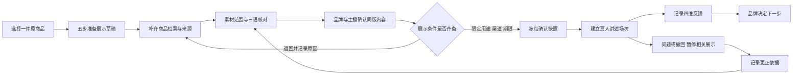
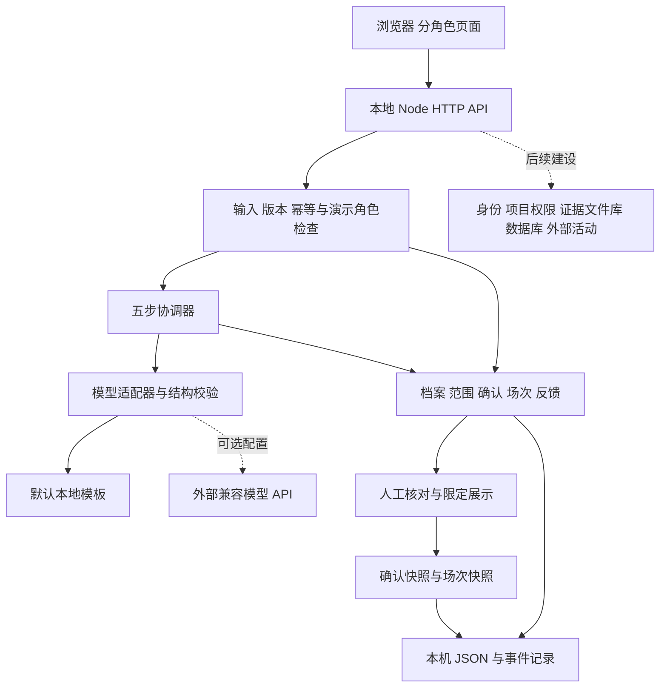

# 来物 Italia：原产商品展示与反馈测试

版本 0.3.0，2026-10-11。以用户最后确认为实施范围：**四类原产商品的中国市场展示与反馈测试，暂停纺织配饰共创。**

## 产品与商业范围

从开心果酱、意大利巧克力、意大利香水、意大利咖啡中选择一个商品，用原始资料准备中文展示，在深圳开展有范围的真人讲述和反馈记录。米兰是接触品牌的入口，不能由此推定商品在米兰设计、制造或拥有某种文化认证。

首批访谈对象相应调整为：可接触、愿意提供商品与来源资料、能说明展示权利、希望了解中国消费者反应的品牌或适当授权方。原先“可授权图案、愿意开发中国限定纺织款”的筛选条件暂停适用。小规模展示研究包是否有人愿意付费，仍需真实访谈和交付验证。

交付物是一套经人工核对的展示资料、版本化场次记录和四维反馈报告。当前不撮合成交，不计算生产成本、进口税费或利润，也不把兴趣计为订单。四品类是候选池，第一笔真实试点宜选择一个品牌、一个具体商品和一个测试问题。

中意合作网络可以提供访谈线索，但不代表已经获得客户。[中国意大利商会 2026 调查报告](https://www.cameraitacina.com/documents/node/0000833/2026businesssentimentsurveycompressed.pdf)。原方案参考的意大利制造推广强调原产地与制造品质；本轮保留原商品，把制造地作为独立待核字段。[Milano Unica 官方介绍](https://www.milanounica.it/en/the-international-trade-agency-ice-and-milano-unica-bring-the-excellence-of-made-in-italy-textiles-to-shanghai)。这些是选方向的背景，不是食品或香水在中国的需求证据。

## 用户体验与交接

| 阶段 | 页面与视角 | 保存结果 |
|---|---|---|
| 选择商品 | 灵感集市、展示策划 | 商品 ID、目标人群、测试价假设、待验证问题 |
| 准备展示 | 五步准备时间线 | 草稿、实际时间、模板或模型来源、失败原因 |
| 补齐资料 | 品牌方 / 中文或 English | 品牌、具体地区、制造地、规格、配料或成分、依据、作者、三语材料 |
| 核对原文 | 文化与译审 | 素材范围、署名、依据、期限、原文与译文确认 |
| 准备讲述 | 品牌、真人主播 | 同版品牌确认、中文与英文讲稿确认 |
| 确认展示 | 展示确认 | 版本、依据、视角、用途、渠道、期限、完整内容快照 |
| 真人测试 | 主播、观众 | 场次、冻结内容、现场讲述、四维反馈 |
| 处理问题 | 主播、展示确认 | 问题、时间、场次、暂停、更正依据；重新确认后另建场次 |
| 品牌复盘 | 品牌方 | 原话、体验方式、版本、下一步理由、测试资料包 |



用户界面采用“品牌方”“文化与译审”“展示确认”等面向参与者的语言。五步默认每步至少两秒；耗时为真实记录，模板模式包含留给阅读的时间，不冒充模型思考。

## Agent、模型与外部边界

保留 Node.js / 原生浏览器工程。元 Agent 是有限流程协调器，不自主寻找品牌、签约、授权或发布。文化整理、展示策划和双语稿共用服务端模型适配器；商品资料核对与发布前检查走规则。默认使用本地模板。



模型只读取节点所需输入与依赖；密钥留在服务端。每次运行三个模型节点，输出结构无效则失败并保存已完成步骤。没有以新框架重写现有 Agent，也没有自动执行外部商业动作。

## 数据与接口增量

新项目 `brief.edition = "italia-originals"`，`productId` 属于 `pistachio / chocolate / perfume / coffee`，与品类一一对应。`business.route = "IT"`；原有 R0–R5 留作历史兼容。

`business.italia` 保存接洽城市、测试城市、`dossier`、`translationReview`、`publication`、`history`、`incidents`。确认记录包含版本、用途、渠道、有效期、依据、演示视角和时间。确认快照保存当时档案、生成结果、素材范围、各方确认、测试价及 AI 使用说明。场次另行冻结当次展示内容，反馈绑定该场次版本。

新动作沿用 `POST /api/projects/:id/business`：

```json
{
  "action": "releaseReview",
  "role": "reviewer",
  "requestId": "每次新操作的唯一编号",
  "expectedVersion": 8,
  "contentRevision": 3,
  "decision": "approve",
  "channel": "local-preview",
  "expiresAt": "2026-10-18T15:59:59.000Z",
  "note": "实际核对的依据与本次范围",
  "rightsChecked": true,
  "factsChecked": true,
  "peopleChecked": true,
  "aiChecked": true
}
```

示例数字与日期需替换为当前项目值；过期日期会被拒绝。`role` 仅为本机演示视角，不是认证身份。

| action | 视角 | 作用 |
|---|---|---|
| `dossier` | brand | 保存完整表单；允许不完整草稿，不能据此放行 |
| `translationReview` | culture | 保存意大利语、英文、中文的人工核对 |
| `rights` | culture | 登记或撤回本地展示范围；不允许打样用途 |
| `confirm` | brand / culture / host | 各自确认对应内容，不代其他视角确认 |
| `releaseReview` | reviewer | approve / return；校验各项确认、材料项与期限 |
| `session` | host | 条件齐备后建立场次与快照 |
| `incident` | host / reviewer | 记录问题，关闭场次，撤销确认，隐藏展示快照 |
| `resolveIncident` | reviewer | 保存更正依据，仍须重新确认；不恢复旧场次 |
| `decision` | brand | 记录基于指定场次的下一步 |

IT 路线拒绝 `profile / spec / quote / sample`，不能用旧接口绕回生产询价。写操作有预期版本和幂等编号；素材、档案、中英文稿变更后，当前确认失效。

观众反馈沿用 `POST /api/projects/:id/observations`，新增必填项：

```json
{
  "sessionId": "实际场次 UUID",
  "requestId": "唯一反馈编号",
  "channel": "campus",
  "dimension": "sensory",
  "experience": "visual-only",
  "decision": "unclear",
  "useCase": "日常使用",
  "note": "仅看过照片，希望了解商品标签里的配料说明。"
}
```

`dimension` 为 packaging / story / sensory / price；`experience` 为 visual-only / sample-experienced。实物体验属于用户自述，不自动视为已核验事实。反馈数是录入次数，不是去重人数或成交数。

## 展示停止与版本规则

确认有效期不得晚于素材范围；反馈截止为场次创建后 24 小时、素材截止和确认截止三者中最早时间。内容修改后须重新确认；有效旧场次仍可接收补充反馈并绑定旧版本。

退回、素材撤回或问题暂停会关闭相关场次并隐藏快照。更正结果不自动恢复旧场次，须重新确认并另建场次。到期后服务端拒绝反馈并隐藏过期快照。观众页保留场次选择，可切换至其他有效场次。

可见的舞台与观众页每 3 秒刷新展示状态，重新获得焦点时也会检查；网络失败时收起本地展示。独立停止按钮立即停止本机画面与特效。当前没有外部直播接入，本机停止不等于外部平台回执。

## 五张附件图与实现关系

| 附件 | 本轮落地 | 尚未实现 |
|---|---|---|
| 01 业务流程与角色交接 | 项目、资料、人工确认、场次、反馈、下一步 | 服务签约、实际获客；生产询价因范围调整暂停 |
| 02 Agent 与人工介入 | 有限流程、依赖生成、规则提示、人工确认、问题处理 | 后台任务队列、通用取消恢复、经过评估的品牌知识复用 |
| 03 分角色页面与交互 | 品牌、文化与译审、主播、展示确认、公众体验 | 真实权限和供应商隔离；供应商页面不进入 IT 主线 |
| 04 系统架构与外部边界 | Node API、模型适配、结构校验、JSON 和记录 | 组织数据库、受控证据文件库、身份授权、外部活动接口 |
| 05 审核放行与异常处理 | 版本、依据、视角、用途、渠道、期限、退回、快照、暂停、更正 | 真实身份签名、证据核验、外部平台发布和停止回执 |

## 照片与验收

`IMG_17188.jpg` 对应开心果酱；`IMG_17189.jpg` 对应巧克力；`IMG_17187.jpg` 对应香水；`IMG_17186.jpg` 对应咖啡。原文件直接复制到 `public/images/italia-*.jpg`，仅以 CSS 显示裁切；首页主图使用香水照片。完整映射见 [图片说明](../public/images/README.md)。

后端运行 `node --test tests/*.test.mjs`，包含 24 项检查。浏览器运行 `node scripts/verify-italia-ui.cjs`，覆盖创建、档案、译审、确认、场次、四维反馈、导出、重载、修订、暂停、更正和移动端。测试项目存于 `.local`，截图与导出位于 `artifacts`，均不提交仓库。

下一步应拿到一个真实品牌的可核对资料，约定研究交付和验收标准，再验证付费、执行成本及反馈质量；功能完备度不能代替需求证据。
